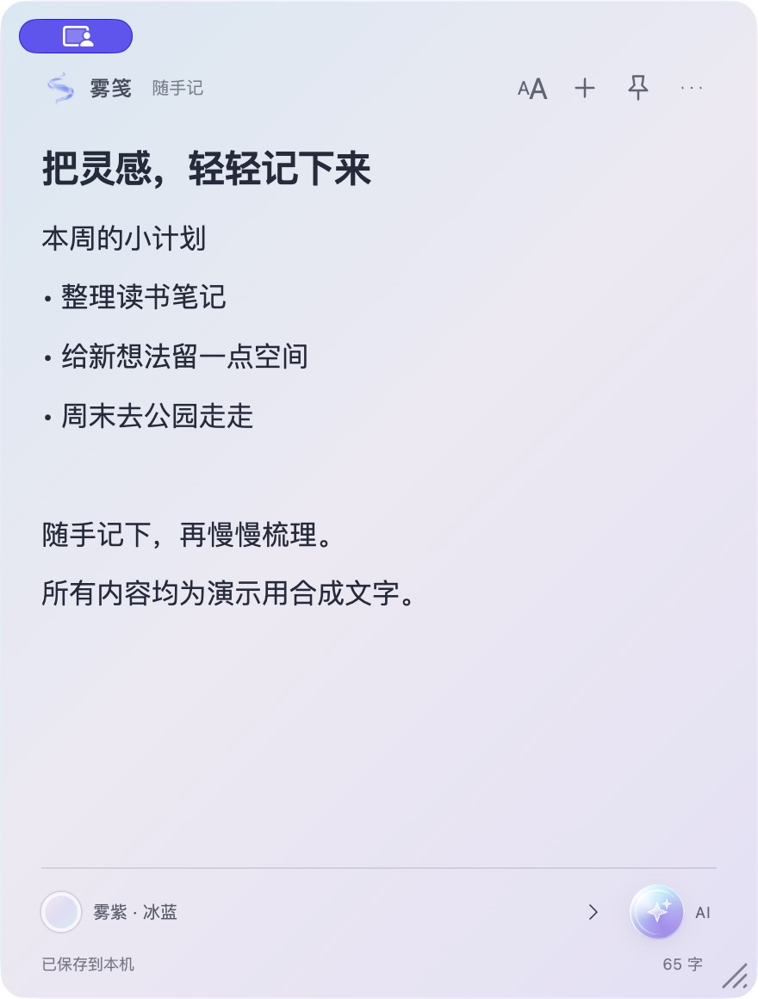
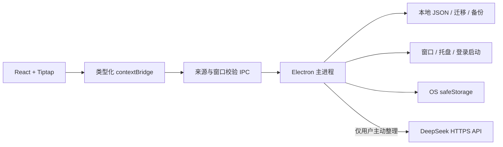

# 雾笺 · Mist Notes

保存在本机的桌面便签：自由缩放、精细字号、持续变色的渐变背景，以及可选的一键 AI 整理。

[English](README.en.md) · [开发与打包](docs/BUILDING.md) · [架构](docs/ARCHITECTURE.md) · [贡献](CONTRIBUTING.md) · [安全](SECURITY.md)

> 当前版本为 `2.1.0-beta.6`。项目所有者已于 2026-10-26 确认采用 MIT 许可证，并批准公开所列自有代码、六个运行图标及合成内容截图。源码仓库：[fu379410-cell/mist-notes](https://github.com/fu379410-cell/mist-notes)。CI 的实际执行结果见 [GitHub Actions](https://github.com/fu379410-cell/mist-notes/actions)。

## 真实界面



此图来自当前候选的实际 macOS 运行窗口，仅含合成文字，不含私人便签。静态截图不展示持续变色；左上角共享指示由 macOS 采集环境显示。

## 为什么做雾笺

临时想法、工作草稿和待整理事项需要一个随手可写、容易阅读的小窗口。雾笺将便签保存在本机，允许每张便签独立调整窗口、字体与配色。需要重新梳理文字时，用户可以主动点击 AI 小球；日常编辑不依赖 AI 服务。

适用于个人桌面上的短笔记与草稿。它目前没有云同步、团队协作、时间提醒或移动端，也不定位为大型知识库。

## 核心功能

- **可缩放便签**：窗口边缘和右下角均可拖动；最小 260×260，正文滚动，大小和位置自动保存，支持置顶和登录启动。
- **拖动调字号**：标题、全文和选区三种范围，1–200；拖动预览，松手提交，一次操作对应一次撤销。
- **240 套渐变**：八类各 30 套，支持搜索、收藏和最近使用；可保存 2–4 节点的自定义配色。
- **整体缓慢变色**：只使用全窗线性渐变，原配色节点轮换交叉；每段约 12 秒，无局部光斑。开启系统“减少动态效果”后放慢三倍。
- **本地数据**：版本化 JSON、上一有效版本、整包合并导入和导出、归档恢复、TXT 导出；从旧版 macOS 便签复制迁移，保留原数据。
- **可选 DeepSeek 整理**：点击小球，整理当前便签并直接应用，一次撤销或重做；再次点击可取消，编辑中的旧结果会被丢弃。

默认字色及统一阅读底层按普通文字 4.5:1 检查；该保证针对默认文字与背景，不覆盖任意粘贴的自定义文字颜色。AI 输出需要自行核对，不能保证事实完全无误；AI 新正文是纯文本，撤销可以恢复原有格式。

## 隐私与 AI

便签保存在操作系统的应用数据目录；应用不包含遥测或云同步模块。只有主动点击 AI 小球时，当前便签的标题、正文及整理指令才发送至 DeepSeek。其他便签不会随请求发送。

API Key 从“更多 → AI 密钥设置”输入，通过 Electron 异步 `safeStorage` 加密，独立存储，不进入便签 JSON、整包导出或源码。已保存密钥的明文不会回传给渲染器；密码框在输入和提交新密钥期间会暂时持有该输入。换电脑后需要重新配置；本机文件加密不等于设备被入侵时仍安全。

## 快速开始

需要 Node.js **24.x**、npm 和 Git。macOS 开发及打包需要 Xcode Command Line Tools；Mac 发行目标为 macOS 13+。Windows 发行目标为 x64。Linux 可运行源码检查，尚未提供发行包或实机支持承诺。

下载源码后，在项目根目录执行：

```sh
cd client
npm ci
npm test
npm run build
npm run dev
```

`npm run dev` 启动 Vite 与 Electron；构建后的启动命令为 `npm start`。常规使用和全部自动测试均不需要 AI 密钥。

为避免开发时读取已有便签，建议使用独立数据目录：

```sh
# macOS / Linux
MIST_DATA_DIR=/tmp/mist-notes-dev MIST_SKIP_MIGRATION=1 npm run dev
```

```powershell
# Windows PowerShell
$env:MIST_DATA_DIR = Join-Path $env:TEMP 'mist-notes-dev'
$env:MIST_SKIP_MIGRATION = '1'
npm run dev
```

`.env.example` 只说明现有环境变量；主进程不会自动载入该文件。不要把 API Key 写入 `.env` 或前端构建配置。

## 技术架构



TypeScript、React、Tiptap、Vite 和 Electron 的版本均由 `client/package-lock.json` 固定。动态背景使用同一时间轴上的透明度合成，输入与保存不重启动画；对比度计算覆盖原节点的 sRGB 混合范围。编辑事务、数据校验和密钥存储均有独立模块测试，详见 [架构说明](docs/ARCHITECTURE.md)。

## 项目结构

```text
client/
  src/             React 界面、编辑器、配色和共享类型
  electron/        主进程、IPC、存储、迁移及 AI 服务
  tests/           自动化回归测试
  scripts/         构建、安全、许可证及产物检查
  resources/       运行所需图标，授权状态见素材清单
Sources/ Tests/    原生 Swift 1.2 回退实现及测试
docs/             架构、验证、已知问题和申请材料
.github/          CI、手动发布工作流及协作模板
```

Swift 回退版是独立的 ARM64/macOS 13+ 实现，使用旧版数据目录，不是 Electron 客户端的共用业务层；构建方式见 [开发文档](docs/BUILDING.md)。

## 构建、验证与发布

```sh
# 在 client/ 执行
npm run security:scan
npm run licenses:check
npm run package:mac       # 在 macOS 构建 arm64 / x64 DMG
npm run package:windows   # 构建 Windows x64 安装版及免安装版
```

打包命令包含 `--publish never`。GitHub CI 配置覆盖 macOS、Windows、Linux 的测试与构建；发布工作流默认只保留构建产物，手动选择创建 Release 时也只创建草稿。CI 在 GitHub 上首次运行、远程默认分支和真实下载链接均需发布后确认。

当前本地验证和限制见 [验证记录](docs/VERIFICATION.md)。Windows 与 Intel Mac 的实机安装、输入法、多屏及缩放仍待验收；本地测试签名不等于正式签名或 Apple 公证。系统菜单快速导出等具体限制见 [已知问题](docs/KNOWN_ISSUES.md)。

## 开发计划与贡献

下一阶段优先修复系统菜单的保存队列衔接、补齐 Windows/Intel 实机回归，再考虑可勾选待办、搜索分类、误删恢复与历史版本。提醒、图片和同步尚未实现，不作为现有能力宣传。

欢迎以可复现的 Issue、小范围 PR 和真实设备验收参与；提交前请阅读 [CONTRIBUTING.md](CONTRIBUTING.md)。目前没有经核实的公开用户量、Stars、下载量或外部贡献数据。历史版本见 [CHANGELOG.md](CHANGELOG.md)。

## 许可证与素材

项目自有代码、经所有者确认的六个运行图标，以及合成截图中的项目自有内容采用 [MIT 许可证](LICENSE)，版权告示为 `Copyright (c) 2026 Mist Notes contributors`。所有者已于 2026-10-26 确认公开授权；第三方依赖、标识和系统界面元素保留各自权利。

第三方依赖保留各自许可证，见 [第三方说明](THIRD_PARTY_NOTICES.md)。生成图标的来源、暂缓公开的 PingFang 轮廓字标及授权边界见 [素材清单](docs/ASSETS_AND_LICENSES.md)。没有将个人便签、密钥、安装器、备份或旧机器报告放入候选仓库。
